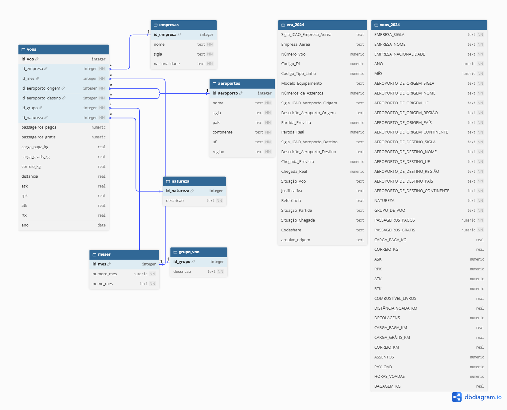

# Projeto ANAC

🚧 Em andamento

Projeto de portfólio em análise de dados, com dados públicos da Agência Nacional da Aviação Civil (ANAC), com objetivo de gerar insights sobre cancelamentos, atrasos e ocupação de voos.

--- 

## Stack

SQLite
| Python
| Git/Github

---

## Ferramentas

SQLite Studio
| VSCode
| Github Desktop

---

## Modelagem do banco de dados

O banco de dados foi estruturado para organizar os dados dos voos e facilitar as consultas e análises. A modelagem utiliza tabelas dimensionais para armazenar informações sobre empresas aéreas, aeroportos, meses, grupos de voo e natureza da operação, relacionadas à tabela principal de voos por meio de chaves primárias e estrangeiras.

<details>
  <summary>Visualizar diagrama do banco de dados</summary>

  

</details>

---
## Estrutura do repositório

```
projeto-anac/
├── database/
│   ├── anac.db
│   └── criacao_schema.sql
├── etl/
│   └── Juncao_vra.py
├── Queries/
│   ├── aeroportos_origem.sql
│   ├── cancelamento_por_aeroporto.sql
│   ├── cancelamento_por_mes.sql
│   ├── comparativo_companhias_rota.sql
│   ├── natureza.sql
│   ├── nivel_1_cancelamento.sql
│   ├── nivel_1_fundamentos.sql
│   ├── pontualidade_por_empresa.sql
│   ├── povoamento_dimensoes.sql
│   ├── povoamento_fato_voos.sql
│   ├── rotas_atrasos.sql
│   ├── taxa_ocupacao.sql
│   └── Manutenção/
├── voos_csv/
│   └── 2024.csv
├── vra_csv/
│   ├── RAW/
│   └── Processed/
├── .gitignore
├── glossario.md
└── README.md
```
--- 

## Banco de Dados

### Fonte dos dados

- [Dados estatísticos do transporte aéreo (ANAC)](https://www.anac.gov.br/acesso-a-informacao/dados-abertos/areas-de-atuacao/voos-e-operacoes-aereas/dados-estatisticos-do-transporte-aereo/48-dados-estatisticos-do-transporte-aereo)
- [VRA — Voos Regulares Ativos, arquivos mensais de 2024 (SIROS/ANAC)](https://siros.anac.gov.br/siros/registros/diversos/vra/2024/)

---

## Análises realizadas

Total de voos por empresa (nivel_1_fundamentos.sql) 
- Contagem geral de voos por empresa aérea.

Cancelamentos por empresa (nivel_1_cancelamento.sql) 
- Quantidade absoluta de cancelamentos por empresa aérea, e taxa de cancelamento (%) considerando o total de voos de cada empresa.

Mês com mais cancelamentos (cancelamento_por_mes.sql) 
- Identifica qual mês de 2024 teve o maior número de voos cancelados.

Top 10 aeroportos com mais cancelamentos (cancelamento_por_aeroporto.sql) 
- Considera o aeroporto tanto como origem quanto como destino de voos cancelados.

Top 10 aeroportos de origem (aeroportos_origem.sql) 
- Os 10 aeroportos com maior volume de voos partindo deles.

Top 10 rotas com mais atrasos (rotas_atrasos.sql) 
- Rotas (origem-destino) com maior número de voos atrasados na partida.

Top 10 empresas mais pontuais (pontualidade_por_empresa.sql) 
- Taxa de pontualidade considerando partida e chegada simultaneamente, com filtro de volume mínimo de voos para evitar distorção estatística.

Taxa de ocupação por empresa (taxa_ocupacao.sql) 
- Load factor (RPK/ASK) de cada empresa aérea.

Comparativo de companhias por rota (comparativo_companhias_rota.sql) 
- Compara a taxa de cancelamento entre empresas que operam a mesma rota (concorrência direta), filtrando rotas com volume relevante de voos.
